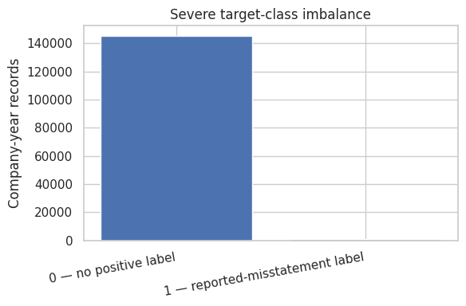
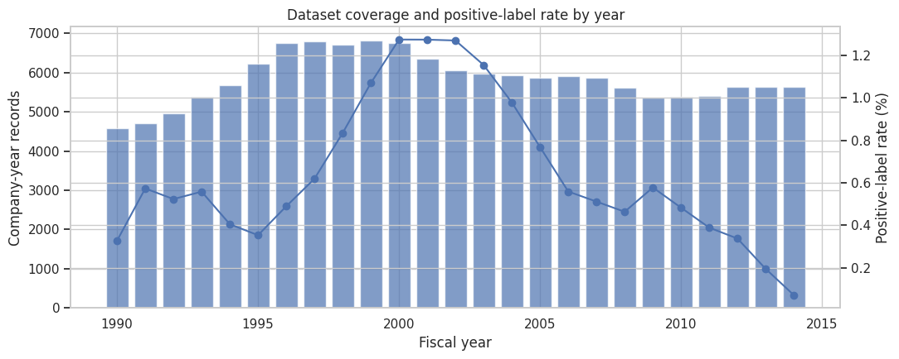
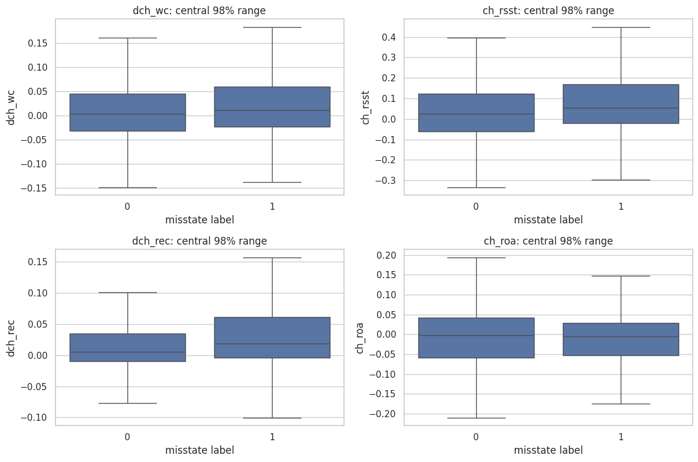
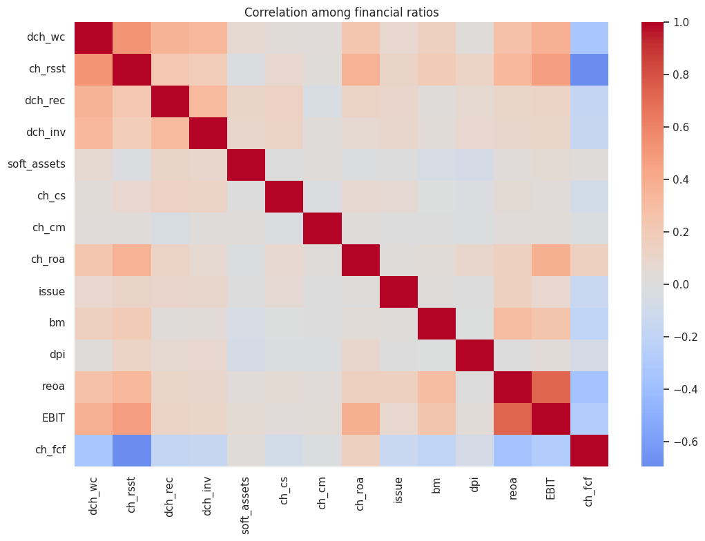
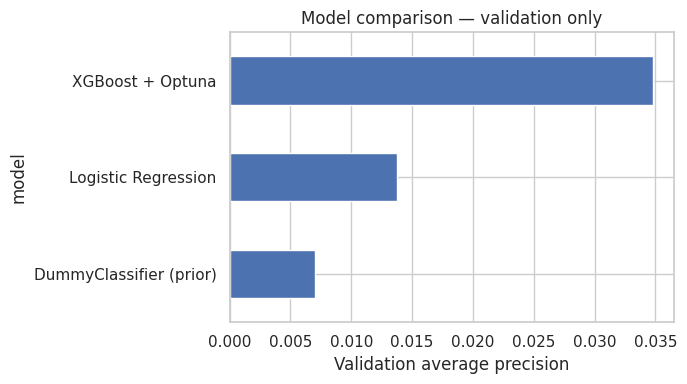
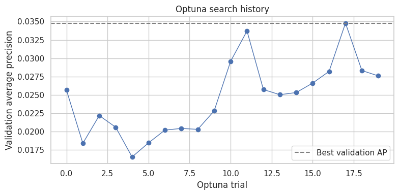
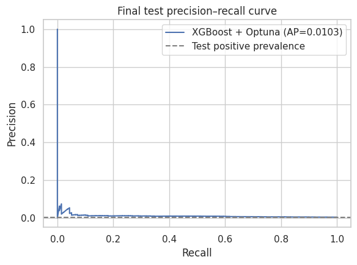
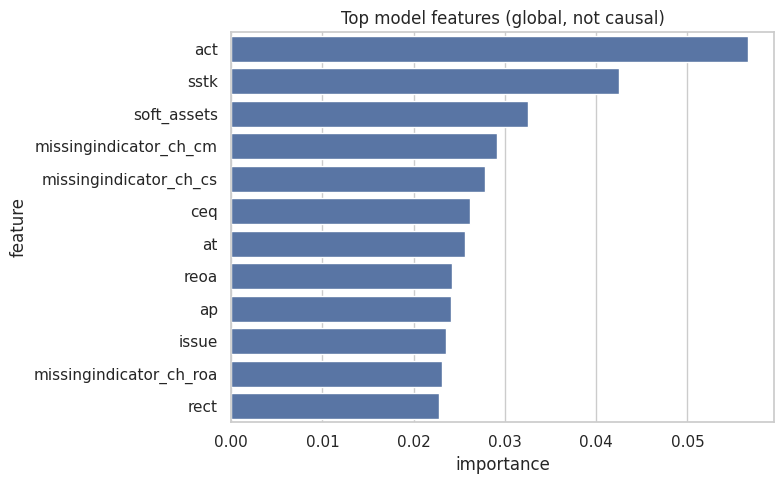

# Financial Statement Anomaly Analysis & Risk Screening

Ranking company-year financial records for analyst review, using accounting data and financial ratios linked to reported misstatements.

**Stack:** Python · Pandas · NumPy · Matplotlib · Seaborn · Scikit-learn · XGBoost · Optuna

> **Responsible-use note:** A model score is a screening signal, not proof of fraud or wrongdoing. The target is an enforcement-linked label from a historical research dataset, and a negative label does not prove a company had no misstatement.

---

## 1. Problem

Auditors and analysts cannot manually review every filing. The question this project asks:

> If an analyst can only review the top **5%** of company-year records, can a model put more labelled misstatements in that queue than random selection would?

Because positives are extremely rare (0.66% of records), accuracy is meaningless here. The headline metric is **average precision (AP / PR-AUC)**, supported by ROC-AUC and the **top-5% review-queue** precision and recall.

## 2. Dataset

| Item | Value |
|---|---|
| File | `data_FraudDetection_JAR2020.csv` |
| Source | Bao, Ke, Li, Yu & Zhang (2020), *Detecting Accounting Fraud in Publicly Traded U.S. Firms Using a Machine Learning Approach*, Journal of Accounting Research |
| Size | 146,045 company-year rows × 46 columns |
| Companies | 18,444 |
| Fiscal years | 1990 – 2014 |
| Target | `misstate` (1 = reported-misstatement label) |
| Positives | 964 (**0.660%**) |
| Duplicates | 0 exact duplicate rows, 0 duplicate company-year keys |

The CSV is **not included** in this repository. Download it from the paper's data release, check its reuse terms, and place it next to the notebook.

**Columns excluded from features (42 predictors remain):**

- `misstate`: the target.
- `p_aaer`: related to AAER / serial-misstatement handling, so it could leak the target.
- `gvkey`: a company identifier, not a generalizable predictor.
- `fyear`: used only for the chronological split and reporting.

## 3. Exploratory analysis

**Severe class imbalance**



**Dataset coverage and positive-label rate by fiscal year**



The positive-label rate drifts downward in later years (for example 0.77% in 2005 versus 0.07% in 2014). This matters for the final test period, which is discussed in the results below.

**Financial ratios by label** (plotted on the central 98% range only; model inputs are not winsorized)



Largest median differences between positive and negative records:

| Ratio | Median (label 0) | Median (label 1) | Difference |
|---|---|---|---|
| `soft_assets` | 0.523 | 0.684 | +0.161 |
| `reoa` | -0.009 | 0.084 | +0.093 |
| `ch_cs` | 0.068 | 0.151 | +0.083 |
| `bm` | 0.443 | 0.377 | -0.066 |

**Correlation among the financial ratios**



## 4. Method

### Chronological split (no random shuffling)

| Split | Fiscal years | Rows | Positives | Positive rate |
|---|---|---|---|---|
| Train | 1990 – 2003 | 83,796 | 660 | 0.788% |
| Validation | 2004 – 2007 | 23,573 | 166 | 0.704% |
| Test | 2008 – 2014 | 38,676 | 138 | 0.357% |

Training on the past and testing on the future avoids look-ahead bias, which a random split would introduce.

### Leakage controls

- `p_aaer`, `gvkey`, and `fyear` are never used as features.
- Imputation (median, with missing-value indicators) and scaling are fitted **inside the pipelines on training data only**.
- The test period is never used for tuning or model selection.

### Models compared

1. **Naive baseline:** `DummyClassifier(strategy='prior')`.
2. **Logistic Regression:** median imputation, standardization, `class_weight='balanced'`.
3. **XGBoost + Optuna:** 20 trials optimizing **validation AP**, searching tree depth, learning rate, regularization, subsampling, and an imbalance multiplier on `scale_pos_weight`.

The winner is chosen on **validation AP only**. It is then refit on train + validation combined and evaluated **once** on the test years.

## 5. Results

### Validation (2004 – 2007)

| Model | Avg. precision | ROC-AUC | Positives in top 5% | Precision@5% | Recall@5% |
|---|---|---|---|---|---|
| **XGBoost + Optuna** | **0.0348** | **0.760** | 37 of 166 | 3.14% | 22.3% |
| Logistic Regression | 0.0137 | 0.689 | 18 of 166 | 1.53% | 10.8% |
| Dummy baseline | 0.0070 | 0.500 | 7 of 166 | 0.59% | 4.2% |

The review queue holds 1,179 records. XGBoost was selected.





Best hyperparameters found: `n_estimators=350`, `max_depth=5`, `learning_rate≈0.078`, `min_child_weight≈10.0`, `subsample≈0.79`, `colsample_bytree≈0.70`, `reg_lambda≈0.26`, `gamma≈1.80`, `imbalance_multiplier≈0.58`.

### Final test (2008 – 2014, untouched until the end)

| Metric | Value |
|---|---|
| Average precision | 0.0103 |
| ROC-AUC | 0.696 |
| Test positive prevalence | 0.357% (138 of 38,676) |
| Review queue size (top 5%) | 1,934 records |
| Labelled positives captured | **22 of 138** |
| Precision@5% | 1.14% |
| Recall@5% | 15.9% |



### How to read these numbers

- **There is real signal, but the problem is hard.** A random 5% queue would capture about 5% of positives (roughly 7 of 138). The model captures 22, which is about **3x better than random selection**.
- **Performance dropped from validation to test.** ROC-AUC went from 0.76 to 0.70, and AP went from 0.035 to 0.010. Part of this is a lower base rate in the test years (0.357% versus 0.704%). Concept drift and label lag in later years (misstatements may not yet have been labelled) are plausible contributors, but this project does not test those explanations.
- **Absolute precision is low.** Even in the top-5% queue, only about 1 in 90 flagged records carries a positive label. This is a prioritization aid, not a detector.
- Scores are best read as a **ranking**, not as calibrated probabilities.

### Feature importance



Top features by XGBoost split-based importance: `act`, `sstk`, `soft_assets`, and the missing-value indicators for `ch_cm` and `ch_cs`. This is an inspection aid, **not causal evidence**. The prominence of missingness indicators suggests that *which values are absent* carries information in this dataset.

## 6. Repository structure

```
.
├── Financial_Statement_Anomaly_Analysis.ipynb   # full workflow
├── requirements.txt
├── data_FraudDetection_JAR2020.csv              # NOT included, add it yourself
├── images/                                      # plots used in this README
└── README.md
```

## 7. How to run

```bash
pip install -r requirements.txt
jupyter notebook Financial_Statement_Anomaly_Analysis.ipynb
```

1. Put `data_FraudDetection_JAR2020.csv` in the same folder as the notebook.
2. Run all cells. The Optuna search (20 trials) is the slowest step.

Random seed is fixed at 42. Results were produced with pandas 2.2.3, scikit-learn 1.6.1, xgboost 3.4.1, and optuna 5.0.0.

## 8. Limitations

- Labels come from enforcement actions, so they capture **detected and prosecuted** misstatements only. Undetected cases sit in the negative class.
- Only 138 positives in the test set means the metrics have wide uncertainty; the test numbers should not be over-interpreted.
- The 20-trial Optuna search is deliberately small, so there is likely headroom from further tuning.
- Test-period performance is clearly weaker than validation, so a model like this would need ongoing monitoring and retraining.
- This is a research dataset of US public firms from 1990–2014, so results may not transfer to other markets or periods.

## 9. Possible extensions

- Add confidence intervals (for example by bootstrapping) around test metrics.
- Try rolling-origin (walk-forward) validation across multiple years.
- Add SHAP explanations for individual flagged records.
- Calibrate predicted scores and compare against a simple rules-based screen.

## Reference

Bao, Y., Ke, B., Li, B., Yu, Y. J., & Zhang, J. (2020). Detecting Accounting Fraud in Publicly Traded U.S. Firms Using a Machine Learning Approach. *Journal of Accounting Research*, 58(1), 199–235.
